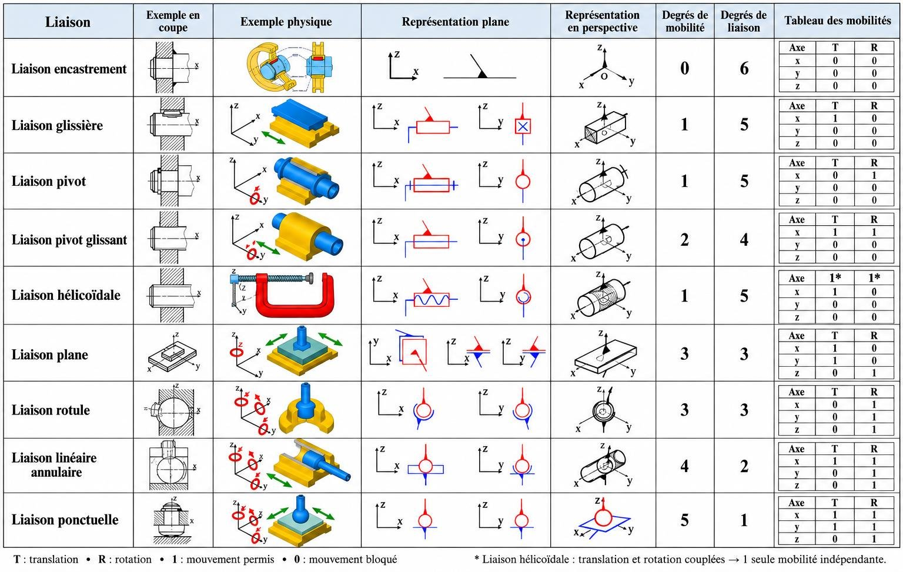

# 3. Module de rappel : les fondamentaux pour la cinématique

Ce module rassemble les outils mathématiques et mécaniques dont le chapitre 2 a besoin : vecteurs, produit scalaire, produit vectoriel, matrices, liaisons et chaînes cinématiques. Les deux exercices sur les repères R1 et R2 sont la base de toute la suite : la matrice de rotation du [cours 4.2](04-description-spatiale/2-reperes-orientation.md) n'est rien d'autre que le tableau de ces produits scalaires.

Pour les bases encore plus élémentaires (sinus, cosinus, radians, multiplication matrice × vecteur), voir les [Rappels](../rappels.md).

## I. Rappels sur les calculs vectoriels

En robotique, un vecteur n'est pas juste une liste de nombres : c'est une entité géométrique qui possède une **direction**, un **sens** et une **norme** (longueur).

### 1. Représentation et norme { #norme }

Intuition
{ .etape }

Un vecteur, c'est une flèche : par exemple le déplacement de la pointe d'un instrument, ou la direction d'un axe du robot. Ses composantes disent « combien » il avance selon chaque axe du repère.

Formalisation
{ .etape }

Par convention en robotique, un vecteur de l'espace est écrit en **colonne** :

\[
\vec{v} = \begin{bmatrix} v_x \\ v_y \\ v_z \end{bmatrix}
\qquad
\|\vec{v}\| = \sqrt{v_x^2 + v_y^2 + v_z^2}
\qquad
\hat{u} = \frac{\vec{v}}{\|\vec{v}\|}
\]

Le vecteur unitaire \(\hat{u}\) a une longueur de 1 : il ne garde que la direction et le sens. C'est la base pour définir les axes X, Y, Z d'un repère robotique.

Exemple
{ .etape }

\(\vec{v} = (2,\ -1,\ 2)^T\) : \(\|\vec{v}\| = \sqrt{4 + 1 + 4} = 3\), donc \(\hat{u} = \left(\tfrac{2}{3},\ -\tfrac{1}{3},\ \tfrac{2}{3}\right)^T\). Vérification : \(\tfrac{4}{9} + \tfrac{1}{9} + \tfrac{4}{9} = 1\).

### 2. Le produit scalaire { #produit-scalaire }

Intuition
{ .etape }

Le produit scalaire mesure « à quel point deux vecteurs vont dans la même direction ». Il est maximal quand ils sont alignés, nul quand ils sont perpendiculaires, négatif quand ils sont opposés. Avec un vecteur unitaire, il donne la **projection** de l'autre vecteur sur cette direction.

Formalisation
{ .etape }

Le produit scalaire de \(\vec{a}\) et \(\vec{b}\) est un **nombre réel** :

\[
\vec{a} \cdot \vec{b} = a_x b_x + a_y b_y + a_z b_z
\qquad\text{(formule algébrique)}
\]

\[
\vec{a} \cdot \vec{b} = \|\vec{a}\|\,\|\vec{b}\|\,\cos\theta
\qquad\text{(formule géométrique, } \theta \text{ angle entre les vecteurs)}
\]

Propriétés clés :

1. Commutatif : \(\vec{a} \cdot \vec{b} = \vec{b} \cdot \vec{a}\)
2. Distributif : \(\vec{a} \cdot (\vec{b} + \vec{c}) = \vec{a} \cdot \vec{b} + \vec{a} \cdot \vec{c}\)
3. Orthogonalité : si \(\vec{a} \cdot \vec{b} = 0\), les vecteurs sont perpendiculaires (ou l'un d'eux est nul).

Applications en santé et en robotique : calculer l'angle d'inclinaison d'un instrument chirurgical par rapport à un os, projeter une force dans une direction, vérifier que deux axes de repère sont orthogonaux (condition essentielle d'une matrice de rotation).

Exemple
{ .etape }

Un instrument est dirigé selon \(\vec{a} = (1,\ 0,\ 1)^T\) ; l'axe d'un os est \(\vec{b} = (0,\ 0,\ 1)^T\). Alors \(\vec{a} \cdot \vec{b} = 1\), \(\|\vec{a}\| = \sqrt{2}\), \(\|\vec{b}\| = 1\), donc

\[
\cos\theta = \frac{1}{\sqrt{2}} \approx 0{,}707 \quad\Rightarrow\quad \theta = 45°
\]

### Application : produits scalaires entre deux repères { #deux-reperes-scalaire }

C'est l'exercice central du module. Le repère du corps S2 tourne d'un angle α par rapport au repère du corps S1 :

\[
\mathcal{R}_1 = (O_1, \vec{x}_1, \vec{y}_1, \vec{z}_1)
\qquad
\mathcal{R}_2 = (O_2, \vec{x}_2, \vec{y}_2, \vec{z}_2)
\qquad
\vec{z}_1 = \vec{z}_2
\qquad
\alpha = (\vec{x}_1, \vec{x}_2) = (\vec{y}_1, \vec{y}_2)
\]

\(\vec{z}_1 = \vec{z}_2\) est dirigé vers l'observateur ; les directions sont comparées à partir d'une origine commune.

<svg class="schema" viewBox="0 0 300 250" width="300" role="img" aria-label="Repères R1 et R2 tournés d'un angle alpha autour de z">
  <defs>
    <marker id="fb" viewBox="0 0 10 10" refX="9" refY="5" markerWidth="7" markerHeight="7" orient="auto-start-reverse"><path d="M0,0 L10,5 L0,10 z" fill="#2f4fa8"/></marker>
    <marker id="fv" viewBox="0 0 10 10" refX="9" refY="5" markerWidth="7" markerHeight="7" orient="auto-start-reverse"><path d="M0,0 L10,5 L0,10 z" fill="#7d3c98"/></marker>
  </defs>
  <line x1="110" y1="190" x2="260" y2="190" stroke="#2f4fa8" stroke-width="2" marker-end="url(#fb)"/>
  <line x1="110" y1="190" x2="110" y2="40" stroke="#2f4fa8" stroke-width="2" marker-end="url(#fb)"/>
  <line x1="110" y1="190" x2="240" y2="115" stroke="#7d3c98" stroke-width="2" marker-end="url(#fv)"/>
  <line x1="110" y1="190" x2="35" y2="60" stroke="#7d3c98" stroke-width="2" marker-end="url(#fv)"/>
  <path d="M 160 190 A 50 50 0 0 0 153.3 165" fill="none" stroke="#1d2330"/>
  <path d="M 110 140 A 50 50 0 0 0 85 146.7" fill="none" stroke="#1d2330"/>
  <circle cx="110" cy="190" r="7" fill="#fff" stroke="#1d2330"/><circle cx="110" cy="190" r="2" fill="#1d2330"/>
  <text x="264" y="204" fill="#2f4fa8" font-size="15" font-style="italic">x₁</text>
  <text x="118" y="44" fill="#2f4fa8" font-size="15" font-style="italic">y₁</text>
  <text x="244" y="110" fill="#7d3c98" font-size="15" font-style="italic">x₂</text>
  <text x="20" y="56" fill="#7d3c98" font-size="15" font-style="italic">y₂</text>
  <text x="168" y="180" font-size="14" font-style="italic">α</text>
  <text x="88" y="130" font-size="14" font-style="italic">α</text>
  <text x="70" y="222" font-size="12" fill="#5b6474">z₁ = z₂ vers l'observateur</text>
</svg>

Raisonnement
{ .etape }

Les vecteurs des repères sont unitaires, donc \(\vec{u} \cdot \vec{v} = \|\vec{u}\|\,\|\vec{v}\| \cos\theta = \cos\theta\). Il suffit de lire sur la figure l'angle entre les deux axes :

- \(\vec{x}_1\) et \(\vec{x}_2\) font l'angle α ; de même \(\vec{y}_1\) et \(\vec{y}_2\).
- \(\vec{y}_1\) et \(\vec{x}_2\) font l'angle \(\frac{\pi}{2} - \alpha\) (\(\vec{x}_2\) s'est rapproché de \(\vec{y}_1\)).
- \(\vec{x}_1\) et \(\vec{y}_2\) font l'angle \(\frac{\pi}{2} + \alpha\) (\(\vec{y}_2\) s'est éloigné de \(\vec{x}_1\)).
- \(\vec{z}_1 = \vec{z}_2\) est perpendiculaire à tous les axes x et y.

Corrigé du cours
{ .etape }

| Cas | Produits | Valeur |
|---|---|---|
| Axes perpendiculaires | \(\vec{x}_1 \cdot \vec{y}_1\), \(\vec{z}_2 \cdot \vec{y}_1\), \(\vec{z}_2 \cdot \vec{x}_1\), \(\vec{x}_2 \cdot \vec{z}_1\) | \(0\) |
| Axes séparés par α | \(\vec{x}_1 \cdot \vec{x}_2\), \(\vec{y}_1 \cdot \vec{y}_2\), \(\vec{y}_2 \cdot \vec{y}_1\), \(\vec{x}_2 \cdot \vec{x}_1\) | \(\cos\alpha\) |
| Axes croisés | \(\vec{y}_1 \cdot \vec{x}_2 = \cos(\frac{\pi}{2} - \alpha)\) | \(\sin\alpha\) |
| Axes croisés | \(\vec{x}_1 \cdot \vec{y}_2 = \cos(\frac{\pi}{2} + \alpha)\), \(\vec{y}_2 \cdot \vec{x}_1\) (commutativité) | \(-\sin\alpha\) |

Les deux produits croisés ont des **signes opposés** : c'est la source de tous les « \(-\sin\alpha\) » des matrices de rotation. Les formules \(\cos(\frac{\pi}{2} \pm \alpha)\) sont rappelées dans [Rappels : trigonométrie](../rappels.md#trigo).

Exemple numérique : pour \(\alpha = 30°\), \(\vec{x}_1 \cdot \vec{x}_2 = 0{,}866\), \(\vec{y}_1 \cdot \vec{x}_2 = 0{,}5\), \(\vec{x}_1 \cdot \vec{y}_2 = -0{,}5\).

### 3. Le produit vectoriel { #produit-vectoriel }

Intuition
{ .etape }

Le produit vectoriel de deux vecteurs fabrique un **troisième vecteur perpendiculaire aux deux premiers**. C'est ainsi qu'on construit l'axe z d'un repère à partir de x et y, ou l'axe de rotation d'un mouvement. Sa longueur est d'autant plus grande que les deux vecteurs sont « en travers » l'un de l'autre.

Formalisation
{ .etape }

Dans le cours, le produit vectoriel est noté \(\wedge\) : \(\vec{w} = \vec{u} \wedge \vec{v}\).

1. **Direction** : \(\vec{w} \perp \vec{u}\) et \(\vec{w} \perp \vec{v}\) ; \(\vec{w}\) est normal au plan \((\vec{u}, \vec{v})\).
2. **Norme et aire** : \(\|\vec{w}\| = \|\vec{u}\|\,\|\vec{v}\|\,\sin\theta\) ; c'est l'aire du parallélogramme construit sur \(\vec{u}\) et \(\vec{v}\).
3. **Règle de la main droite** : on enroule les doigts de \(\vec{u}\) vers \(\vec{v}\) ; le pouce indique le sens de \(\vec{w}\).

Propriétés :

\[
\vec{u} \wedge \vec{v} = -(\vec{v} \wedge \vec{u}) \quad\text{(anticommutativité)}
\qquad
\vec{u} \wedge (\vec{v} + \vec{t}) = \vec{u} \wedge \vec{v} + \vec{u} \wedge \vec{t} \quad\text{(distributivité)}
\]

\[
\vec{u} \wedge \vec{v} = \vec{0} \iff \vec{u} \text{ et } \vec{v} \text{ parallèles, ou l'un des deux est nul}
\]

En coordonnées (les deux vecteurs dans la même base orthonormée directe) :

\[
w_x = u_y v_z - u_z v_y
\qquad
w_y = u_z v_x - u_x v_z
\qquad
w_z = u_x v_y - u_y v_x
\]

Le chapitre 2 écrit le même produit avec le symbole \(\times\) : \(\vec{z} = \vec{x} \times \vec{y}\). Les deux notations désignent la même opération.

Exemple
{ .etape }

\(\vec{u} = (1,\ 2,\ 0)^T\), \(\vec{v} = (0,\ 1,\ 3)^T\) :

\[
\vec{w} = \begin{bmatrix} 2 \cdot 3 - 0 \cdot 1 \\ 0 \cdot 0 - 1 \cdot 3 \\ 1 \cdot 1 - 2 \cdot 0 \end{bmatrix} = \begin{bmatrix} 6 \\ -3 \\ 1 \end{bmatrix}
\]

Vérification : \(\vec{w} \cdot \vec{u} = 6 - 6 + 0 = 0\) et \(\vec{w} \cdot \vec{v} = 0 - 3 + 3 = 0\) : \(\vec{w}\) est bien perpendiculaire aux deux.

### Application : produits vectoriels entre deux repères { #deux-reperes-vectoriel }

Même figure qu'au-dessus. Méthode : le résultat est normal au plan des deux vecteurs, sa norme vaut \(\sin\) de l'angle orienté de l'un vers l'autre (vecteurs unitaires), et son sens suit la règle de la main droite.

- Deux vecteurs du plan \((\vec{x}_1, \vec{y}_1)\) donnent un vecteur porté par \(\vec{z}_1\), de composante \(\sin(\text{angle orienté du premier vers le second})\).
- Un produit avec \(\vec{z}_1 = \vec{z}_2\) donne un vecteur du plan, perpendiculaire aux deux.

Corrigé du cours
{ .etape }

| Produit | Résultat | Angle orienté utilisé |
|---|---|---|
| \(\vec{x}_1 \wedge \vec{y}_1\) | \(\vec{z}_1\) | \(\frac{\pi}{2}\) |
| \(\vec{x}_1 \wedge \vec{x}_2\) | \(\sin\alpha\ \vec{z}_1\) | \(\alpha\) |
| \(\vec{y}_1 \wedge \vec{y}_2\) | \(\sin\alpha\ \vec{z}_1\) | \(\alpha\) |
| \(\vec{z}_2 \wedge \vec{y}_1\) | \(-\vec{x}_1\) | |
| \(\vec{z}_2 \wedge \vec{x}_1\) | \(\vec{y}_1\) | |
| \(\vec{x}_1 \wedge \vec{y}_2\) | \(\cos\alpha\ \vec{z}_1\) | \(\frac{\pi}{2} + \alpha\) : \(\sin(\frac{\pi}{2} + \alpha) = \cos\alpha\) |
| \(\vec{y}_1 \wedge \vec{x}_2\) | \(-\cos\alpha\ \vec{z}_1\) | \(-(\frac{\pi}{2} - \alpha)\) |
| \(\vec{y}_2 \wedge \vec{x}_1\) | \(-\cos\alpha\ \vec{z}_1\) | anticommutativité de la ligne \(\vec{x}_1 \wedge \vec{y}_2\) |
| \(\vec{y}_2 \wedge \vec{y}_1\) | \(-\sin\alpha\ \vec{z}_1\) | \(-\alpha\) |
| \(\vec{x}_2 \wedge \vec{z}_1\) | \(-\vec{y}_2\) | |
| \(\vec{x}_2 \wedge \vec{x}_1\) | \(-\sin\alpha\ \vec{z}_1\) | \(-\alpha\) |

Les résultats sont aussi affichés, avec leur valeur numérique, dans la figure interactive précédente.

### Produit vectoriel de deux vecteurs exprimés dans deux bases

**Développement par distributivité.** Si \(\vec{V}_1 = a_1 \vec{x}_1 + b_1 \vec{y}_1 + c_1 \vec{z}_1\) et \(\vec{V}_2 = a_2 \vec{x}_2 + b_2 \vec{y}_2 + c_2 \vec{z}_2\), alors \(\vec{V}_1 \wedge \vec{V}_2\) est la somme des neuf termes

\[
\begin{aligned}
&a_1 a_2 (\vec{x}_1 \wedge \vec{x}_2) + a_1 b_2 (\vec{x}_1 \wedge \vec{y}_2) + a_1 c_2 (\vec{x}_1 \wedge \vec{z}_2) \\
+\ &b_1 a_2 (\vec{y}_1 \wedge \vec{x}_2) + b_1 b_2 (\vec{y}_1 \wedge \vec{y}_2) + b_1 c_2 (\vec{y}_1 \wedge \vec{z}_2) \\
+\ &c_1 a_2 (\vec{z}_1 \wedge \vec{x}_2) + c_1 b_2 (\vec{z}_1 \wedge \vec{y}_2) + c_1 c_2 (\vec{z}_1 \wedge \vec{z}_2)
\end{aligned}
\]

et chaque produit d'axes se lit dans le tableau ci-dessus.

**Cas où les deux vecteurs sont dans la même base** (\(\vec{x}_1 = \vec{x}_2 = \vec{x}\), etc.) :

\[
\vec{V}_1 = \begin{pmatrix} a_1 \\ b_1 \\ c_1 \end{pmatrix},\quad
\vec{V}_2 = \begin{pmatrix} a_2 \\ b_2 \\ c_2 \end{pmatrix}
\quad\Rightarrow\quad
\vec{V}_1 \wedge \vec{V}_2 = \begin{pmatrix} b_1 c_2 - c_1 b_2 \\ c_1 a_2 - a_1 c_2 \\ a_1 b_2 - b_1 a_2 \end{pmatrix}
\]

Condition : les composantes des deux vecteurs doivent être données dans une même base orthonormée directe. Sinon, on projette d'abord l'un des vecteurs dans la base de l'autre (paragraphe suivant).

### Application : projections entre deux repères { #projections }

Intuition
{ .etape }

Exprimer \(\vec{x}_2\) dans R1, c'est répondre à : « de combien \(\vec{x}_2\) avance-t-il selon \(\vec{x}_1\), selon \(\vec{y}_1\), selon \(\vec{z}_1\) ? ». Chaque réponse est un produit scalaire, déjà calculé plus haut.

Formalisation
{ .etape }

Pour tout vecteur \(\vec{V}\) et une base orthonormée \((\vec{x}_1, \vec{y}_1, \vec{z}_1)\) :

\[
\vec{V} = (\vec{V} \cdot \vec{x}_1)\,\vec{x}_1 + (\vec{V} \cdot \vec{y}_1)\,\vec{y}_1 + (\vec{V} \cdot \vec{z}_1)\,\vec{z}_1
\]

Avec les produits scalaires du corrigé :

| Axes de R2 exprimés dans R1 | Axes de R1 exprimés dans R2 |
|---|---|
| \(\vec{x}_2 = \cos\alpha\ \vec{x}_1 + \sin\alpha\ \vec{y}_1\) | \(\vec{x}_1 = \cos\alpha\ \vec{x}_2 - \sin\alpha\ \vec{y}_2\) |
| \([\vec{x}_2]_{\mathcal{R}_1} = (\cos\alpha,\ \sin\alpha,\ 0)^T\) | \([\vec{x}_1]_{\mathcal{R}_2} = (\cos\alpha,\ -\sin\alpha,\ 0)^T\) |
| \(\vec{y}_2 = -\sin\alpha\ \vec{x}_1 + \cos\alpha\ \vec{y}_1\) | \(\vec{y}_1 = \sin\alpha\ \vec{x}_2 + \cos\alpha\ \vec{y}_2\) |
| \([\vec{y}_2]_{\mathcal{R}_1} = (-\sin\alpha,\ \cos\alpha,\ 0)^T\) | \([\vec{y}_1]_{\mathcal{R}_2} = (\sin\alpha,\ \cos\alpha,\ 0)^T\) |

Les composantes selon l'axe commun z sont nulles ; les signes de \(\sin\alpha\) changent avec le repère choisi.

Si l'on range \([\vec{x}_2]_{\mathcal{R}_1}\), \([\vec{y}_2]_{\mathcal{R}_1}\) et \([\vec{z}_2]_{\mathcal{R}_1}\) en colonnes, on obtient exactement la **matrice de rotation** \(R_z(\alpha)\) du [cours 4.2](04-description-spatiale/2-reperes-orientation.md#matrice-rotation). *(complément)*

Exemple
{ .etape }

\(\alpha = 30°\) : \([\vec{x}_2]_{\mathcal{R}_1} = (0{,}866;\ 0{,}5;\ 0)^T\) et \([\vec{y}_2]_{\mathcal{R}_1} = (-0{,}5;\ 0{,}866;\ 0)^T\). Le vecteur \(\vec{V} = 2\vec{x}_2\) vaut donc \((1{,}732;\ 1;\ 0)^T\) dans R1.

## II. Calcul matriciel

### 1. Qu'est-ce qu'une matrice ?

Une matrice est un **tableau rectangulaire de nombres** (ou de données) organisé en **lignes** et en **colonnes**. « Une matrice regroupe des informations sur des données » : c'est un conteneur qui stocke plusieurs informations de manière structurée. Exemples : la position d'un point \((x, y, z)^T\), les vitesses de plusieurs points, des informations sur des appartements (surface, prix, nombre de chambres).

### 2. Dimensions d'une matrice

Une matrice de dimension \([m \times n]\) possède \(m\) lignes et \(n\) colonnes.

\[
M_1 = \begin{pmatrix} a_1 & d_1 \\ b_1 & e_1 \\ c_1 & f_1 \end{pmatrix}\ [3 \times 2]
\qquad
M_2 = \begin{pmatrix} a_2 & d_2 \\ b_2 & e_2 \\ c_2 & f_2 \end{pmatrix}\ [3 \times 2]
\qquad
M_3 = \begin{pmatrix} m_3 & n_3 & o_3 & p_3 \\ q_3 & r_3 & s_3 & u_3 \end{pmatrix}\ [2 \times 4]
\]

### 3. Opérations sur les matrices { #matrices }

**3.1 Addition.** On ne peut additionner que des matrices de même dimension, terme à terme :

\[
M_1 + M_2 = \begin{pmatrix} a_1 + a_2 & d_1 + d_2 \\ b_1 + b_2 & e_1 + e_2 \\ c_1 + c_2 & f_1 + f_2 \end{pmatrix}
\]

\(M_1 + M_3\) est impossible : \([3 \times 2] + [2 \times 4]\).

**3.2 Multiplication.**

Intuition
{ .etape }

Chaque élément du produit est le produit scalaire d'une **ligne** de la première matrice par une **colonne** de la seconde. Il faut donc que la ligne et la colonne aient la même longueur.

Règle d'or
{ .etape }

> Pour multiplier A par B, le nombre de colonnes de A doit être égal au nombre de lignes de B. Si A est \([m \times n]\) et B est \([n \times p]\), alors \(A \times B\) est une matrice \([m \times p]\).

**Exemple 1 : \(M_1 \times M_3\) (possible).** \(M_1\) a 2 colonnes, \(M_3\) a 2 lignes : le résultat est \([3 \times 4]\).

\[
\text{Élément}_{1,1} = (a_1 \times m_3) + (d_1 \times q_3)
\]

\[
M_1 \times M_3 = \begin{pmatrix}
a_1 m_3 + d_1 q_3 & a_1 n_3 + d_1 r_3 & a_1 o_3 + d_1 s_3 & a_1 p_3 + d_1 u_3 \\
b_1 m_3 + e_1 q_3 & b_1 n_3 + e_1 r_3 & b_1 o_3 + e_1 s_3 & b_1 p_3 + e_1 u_3 \\
c_1 m_3 + f_1 q_3 & c_1 n_3 + f_1 r_3 & c_1 o_3 + f_1 s_3 & c_1 p_3 + f_1 u_3
\end{pmatrix}
\]

**Exemple 2 : \(M_3 \times M_1\) (impossible).** \(M_3\) a 4 colonnes, \(M_1\) a 3 lignes : \(4 \neq 3\).

> En calcul matriciel, l'ordre compte : \(A \times B \neq B \times A\) (et parfois l'un est possible et pas l'autre).

Exemple numérique
{ .etape }

\[
\begin{pmatrix} 1 & 2 \\ 0 & 1 \\ 3 & -1 \end{pmatrix}
\begin{pmatrix} 2 & 0 & 1 & -1 \\ 1 & 3 & 0 & 2 \end{pmatrix}
=
\begin{pmatrix} 4 & 6 & 1 & 3 \\ 1 & 3 & 0 & 2 \\ 5 & -3 & 3 & -5 \end{pmatrix}
\]

Par exemple, l'élément (3, 4) vaut \(3 \times (-1) + (-1) \times 2 = -5\).

**3.3 Transposée.** On échange les lignes et les colonnes : la première ligne devient la première colonne.

\[
M_1 = \begin{pmatrix} a_1 & d_1 \\ b_1 & e_1 \\ c_1 & f_1 \end{pmatrix}
\ \xrightarrow{\text{Transposée}}\
M_1^T = \begin{pmatrix} a_1 & b_1 & c_1 \\ d_1 & e_1 & f_1 \end{pmatrix}
\]

\(M_1\) est \([3 \times 2]\), \(M_1^T\) est \([2 \times 3]\). La transposée sert au cours 4 : l'inverse d'une matrice de rotation est sa transposée.

### 4. Propriétés importantes

| Propriété | Expression |
|---|---|
| Commutativité de l'addition | \(A + B = B + A\) |
| Non-commutativité de la multiplication | \(A \times B \neq B \times A\) (en général) |
| Associativité | \((A \times B) \times C = A \times (B \times C)\) |
| Distributivité | \(A \times (B + C) = A \times B + A \times C\) |

L'associativité permet d'écrire sans parenthèses la chaîne \(T^{0,1} T^{1,2} \cdots T^{n-1,n}\) du [cours 4.3](04-description-spatiale/3-transformations-homogenes.md) ; la non-commutativité explique pourquoi l'ordre des rotations doit toujours être précisé.

## III. Présentations : liaisons et chaînes cinématiques

### 1. Liaisons { #liaisons }

Objectif : comprendre comment les segments rigides d'un robot sont connectés entre eux pour créer du mouvement, et comment l'ordinateur modélise ces connexions.

**1-1 Définition simple.** Un manipulateur robotique est une chaîne de corps rigides appelés **liens** (ou segments). Les **liaisons** sont les connexions physiques entre deux liens voisins. Si les liens sont les « os » du robot, les liaisons en sont les « articulations ». Leur rôle est de permettre un **mouvement relatif** entre les deux liens qu'elles connectent.

**1-2 Degré de liberté (DDL).** Chaque liaison apporte généralement **1 DDL** au système mécanique. C'est la **variable** que le **moteur** (l'actionneur) va contrôler. Un robot à 6 liaisons possède 6 DDL ; son état est décrit par un vecteur de 6 valeurs, par exemple \([\theta_1, \theta_2, d_3, \theta_4, \theta_5, \theta_6]\).

**1-3 Les deux types fondamentaux de liaisons.**

| | Liaison pivot (R) | Liaison glissière (P) |
|---|---|---|
| Mouvement | une rotation relative autour d'un axe fixe | une translation rectiligne le long d'un axe fixe |
| Mobilité | \(R_z\) (rotation autour de z) | \(T_x\) (translation selon x) |
| Variable contrôlée | \(q = \theta\) (angle) | \(q = d\) (distance) |
| DDL | 1, pas de translation | 1, aucune rotation |
| Analogie | coude (flexion, extension) | tiroir, vérin |
| Exemple médical | poignet articulé d'un robot chirurgical (da Vinci) | plateau d'IRM (translation guidée du patient) |

Avec une liaison pivot, l'extrémité du segment mobile décrit un arc de cercle.

**1-4 Tableau des liaisons normalisées.** Les neuf liaisons usuelles, avec leurs mobilités (1 : mouvement permis, 0 : bloqué ; l'axe de la liaison est x) :

<figure markdown>
{ loading=lazy }
<figcaption>Tableau des liaisons normalisées (figure du cours).</figcaption>
</figure>

| Liaison | Mouvements permis | Degrés de mobilité | Degrés de liaison |
|---|---|---|---|
| Encastrement | aucun | 0 | 6 |
| Glissière | \(T_x\) | 1 | 5 |
| Pivot | \(R_x\) | 1 | 5 |
| Pivot glissant | \(T_x, R_x\) | 2 | 4 |
| Hélicoïdale | \(T_x\) et \(R_x\) couplées | 1 | 5 |
| Plane (normale z) | \(T_x, T_y, R_z\) | 3 | 3 |
| Rotule | \(R_x, R_y, R_z\) | 3 | 3 |
| Linéaire annulaire | \(T_x, R_x, R_y, R_z\) | 4 | 2 |
| Ponctuelle (normale z) | \(T_x, T_y, R_x, R_y, R_z\) | 5 | 1 |

Dans la liaison hélicoïdale, translation et rotation sont couplées (comme une vis) : une seule mobilité indépendante. Dans chaque ligne, degrés de mobilité + degrés de liaison = 6. *(complément)*

### 2. Chaîne cinématique { #chaine }

> C'est une représentation plane ou spatiale des liaisons qui existent entre les solides, en respectant le tableau normalisé des liaisons. Le schéma cinématique prend en considération les formes des contacts entre les solides qui définissent les mouvements possibles pour chaque contact.

Une **chaîne série** (la plus courante) ressemble à un bras humain :

\[
\text{Base} \rightarrow \text{Liaison 1} \rightarrow \text{Lien 1} \rightarrow \text{Liaison 2} \rightarrow \text{Lien 2} \rightarrow \dots \rightarrow \text{Organe terminal (pince, scalpel)}
\]

Le nombre total de liaisons détermine la **dextérité** du robot. Pour atteindre n'importe quelle position et orientation dans l'espace 3D, un robot a besoin d'au minimum **6 liaisons** (6 DDL).

Le cours montre ensuite des schémas cinématiques plans (bras dans le plan X, Y), spatiaux (système bielle-manivelle à coulisse), le schéma du robot sériel ABB à 6 axes et celui du robot Delta. Ils sont repris au [cours 4.1](04-description-spatiale/1-bases-mecaniques.md#schema).

### 3. Construction du schéma cinématique { #construction }

| Exemple | Structure | Mouvements | DDL | Position de l'outil |
|---|---|---|---|---|
| Robot cartésien | PPP | trois liaisons prismatiques, trois translations indépendantes | 3 | \(x = q_1,\ y = q_2,\ z = q_3\) |
| Robot SCARA | RRRP | trois rotations et une translation verticale | 4 | \(\overrightarrow{OM} = f(X_1, X_2, X_3, q)\) |
| Robot articulé | RRRRR | cinq articulations rotoïdes, cinq rotations indépendantes | 5 | \(\overrightarrow{OM} = f(\theta_1, \theta_2, \theta_3, \theta_4, \theta_5)\) |

Pour lire une structure, on énumère les liaisons de la base vers l'effecteur avec leur type (R ou P) ; le nombre de lettres donne le nombre de DDL.

### Rappel : sinus et cosinus { #sinus-cosinus }

Dans un triangle rectangle, pour un angle aigu \(a\) :

\[
\sin(a) = \frac{\text{côté opposé}}{\text{hypoténuse}}
\qquad
\cos(a) = \frac{\text{côté adjacent}}{\text{hypoténuse}}
\]

Suite (cercle trigonométrique, angles négatifs, \(\cos(\frac{\pi}{2} \pm \alpha)\)) dans [Rappels : trigonométrie](../rappels.md#trigo).

## Formules clés

\[
\|\vec{v}\| = \sqrt{v_x^2 + v_y^2 + v_z^2}
\qquad
\hat{u} = \frac{\vec{v}}{\|\vec{v}\|}
\]

\[
\vec{a} \cdot \vec{b} = a_x b_x + a_y b_y + a_z b_z = \|\vec{a}\|\,\|\vec{b}\| \cos\theta
\]

\[
\vec{u} \wedge \vec{v} = \begin{pmatrix} u_y v_z - u_z v_y \\ u_z v_x - u_x v_z \\ u_x v_y - u_y v_x \end{pmatrix},
\qquad
\|\vec{u} \wedge \vec{v}\| = \|\vec{u}\|\,\|\vec{v}\| \sin\theta,
\qquad
\vec{u} \wedge \vec{v} = -\vec{v} \wedge \vec{u}
\]

\[
\vec{x}_2 = \cos\alpha\ \vec{x}_1 + \sin\alpha\ \vec{y}_1
\qquad
\vec{y}_2 = -\sin\alpha\ \vec{x}_1 + \cos\alpha\ \vec{y}_1
\]

\[
[m \times n] \times [n \times p] = [m \times p]
\qquad
A \times B \neq B \times A
\]

Liaison pivot : \(q = \theta\) ; liaison glissière : \(q = d\) ; 6 DDL nécessaires pour une position et une orientation quelconques.

## Questions d'auto-évaluation

1. Calculez la norme de \(\vec{v} = (3, 0, -4)^T\) et le vecteur unitaire associé.

    

Réponse

    \(\|\vec{v}\| = \sqrt{9 + 0 + 16} = 5\) ; \(\hat{u} = (0{,}6;\ 0;\ -0{,}8)^T\).
    

2. Deux vecteurs ont un produit scalaire nul. Que peut-on dire ? Pourquoi est-ce important pour une matrice de rotation ?

    

Réponse

    Ils sont perpendiculaires (ou l'un est nul). Les trois axes d'un repère doivent être deux à deux perpendiculaires : les colonnes d'une matrice de rotation ont des produits scalaires nuls entre elles.
    

3. Dans la figure des deux repères, justifiez \(\vec{x}_1 \cdot \vec{y}_2 = -\sin\alpha\).

    

Réponse

    \(\vec{y}_2\) a tourné de α à partir de \(\vec{y}_1\), donc l'angle entre \(\vec{x}_1\) et \(\vec{y}_2\) vaut \(\frac{\pi}{2} + \alpha\). Les vecteurs sont unitaires, donc le produit scalaire vaut \(\cos(\frac{\pi}{2} + \alpha) = -\sin\alpha\).
    

4. Calculez \(\vec{u} \wedge \vec{v}\) pour \(\vec{u} = (1, 0, 0)^T\) et \(\vec{v} = (0, 1, 0)^T\), puis \(\vec{v} \wedge \vec{u}\).

    

Réponse

    \(\vec{u} \wedge \vec{v} = (0, 0, 1)^T\) : c'est \(\vec{x} \wedge \vec{y} = \vec{z}\). Par anticommutativité, \(\vec{v} \wedge \vec{u} = (0, 0, -1)^T\).
    

5. Exprimez \(\vec{y}_1\) dans le repère R2 pour \(\alpha = 60°\).

    

Réponse

    \(\vec{y}_1 = \sin\alpha\ \vec{x}_2 + \cos\alpha\ \vec{y}_2\), donc \([\vec{y}_1]_{\mathcal{R}_2} = (0{,}866;\ 0{,}5;\ 0)^T\).
    

6. A est \([2 \times 3]\) et B est \([3 \times 3]\). Les produits \(A \times B\) et \(B \times A\) sont-ils possibles ? Quelle est la dimension du résultat ?

    

Réponse

    \(A \times B\) : 3 colonnes et 3 lignes, possible, résultat \([2 \times 3]\). \(B \times A\) : B a 3 colonnes mais A a 2 lignes, impossible.
    

7. Calculez \(\begin{pmatrix} 1 & 2 \\ 3 & 4 \end{pmatrix}\begin{pmatrix} 0 & 1 \\ 1 & 0 \end{pmatrix}\) puis le produit dans l'autre ordre. Conclusion ?

    

Réponse

    Premier ordre : \(\begin{pmatrix} 2 & 1 \\ 4 & 3 \end{pmatrix}\) (les colonnes sont échangées). Autre ordre : \(\begin{pmatrix} 3 & 4 \\ 1 & 2 \end{pmatrix}\) (les lignes sont échangées). Les résultats diffèrent : le produit matriciel n'est pas commutatif.
    

8. Combien de DDL a une liaison pivot glissant ? Une rotule ? Lesquels ?

    

Réponse

    Pivot glissant : 2 (translation et rotation selon le même axe, \(T_x\) et \(R_x\)). Rotule : 3 (trois rotations \(R_x, R_y, R_z\), aucune translation).
    

9. Un robot a la structure RRP. Combien de DDL ? Écrivez son vecteur de variables articulaires.

    

Réponse

    3 DDL : deux pivots et une glissière. \(q = [\theta_1, \theta_2, d_3]\).
    

10. Pourquoi faut-il au moins 6 liaisons pour atteindre n'importe quelle pose dans l'espace ?

    

Réponse

    Une pose dans l'espace demande 6 paramètres indépendants : 3 pour la position et 3 pour l'orientation. Chaque liaison motorisée n'apporte qu'un DDL.
    

