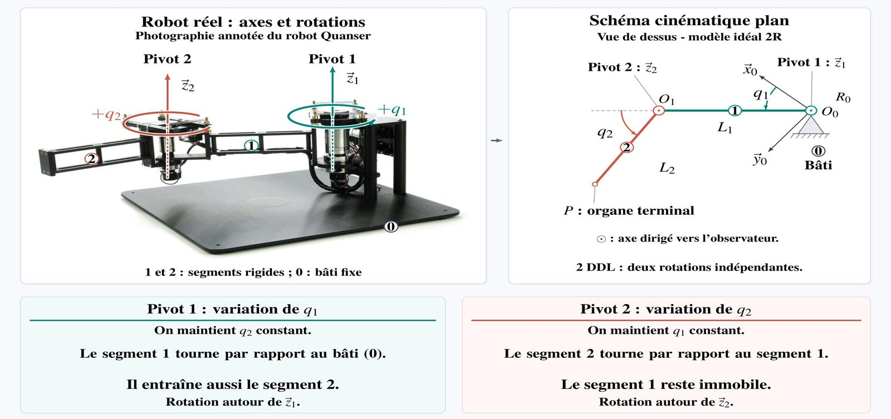
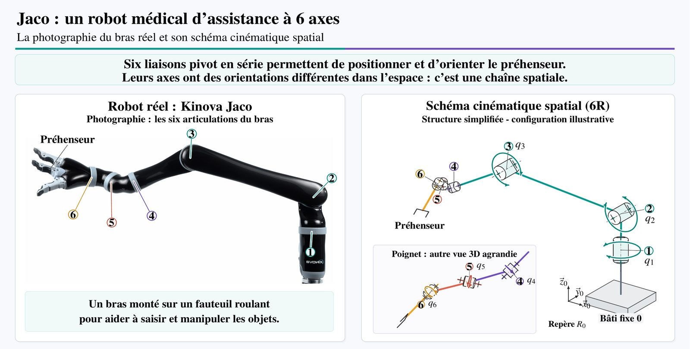

# 4.1 Bases mécaniques et théorie des mécanismes

Partie 1 du chapitre 2. Avant de mettre des nombres sur le mouvement, on fixe le modèle mécanique : des solides rigides, reliés par des liaisons qui autorisent certains mouvements et en bloquent d'autres, représentés par un schéma cinématique.

## I. Le solide indéformable et les degrés de liberté

### 1. L'hypothèse du solide indéformable { #solide-indeformable }

Intuition
{ .etape }

On suppose que les segments du robot ne plient pas. Le segment peut bouger (tourner, se déplacer), mais deux points gravés dessus restent toujours à la même distance l'un de l'autre. C'est cette hypothèse qui permet de décrire le mouvement d'un segment entier avec seulement une rotation et une translation.

Définition
{ .etape }

> Un solide est dit indéformable si la distance entre deux points quelconques de ce solide reste constante au cours du temps, quel que soit son mouvement.

Si A et B sont deux points du solide, aux instants \(t_1\) et \(t_2\) :

\[
\|\overrightarrow{A_1B_1}\| = \|\overrightarrow{A_2B_2}\| = d = \text{constante}
\]

**Pourquoi en robotique ?** La cinématique décrit la géométrie du mouvement (positions, vitesses). Les efforts relèvent de la dynamique ; les déformations sont négligées dans ce modèle. Le mouvement d'un solide indéformable se réduit alors à une rotation et une translation :

\[
\mathbf{p}_2 = \mathbf{R}\,\mathbf{p}_1 + \mathbf{t}
\]

où \(\mathbf{R}\) est une rotation et \(\mathbf{t}\) une translation. Toute la suite du chapitre consiste à écrire proprement ce \(\mathbf{R}\) et ce \(\mathbf{t}\).

**Limite du modèle.** En réalité, les bras de robot fléchissent sous la charge ou les vibrations, mais ces déformations sont considérées comme négligeables pour la modélisation géométrique de base.

Exemple
{ .etape }

Un instrument de 20 cm est tenu par le robot. Ses extrémités A et B sont à 20 cm l'une de l'autre avant et après le mouvement, quelle que soit la façon dont le robot l'a tourné ou déplacé. Si l'on mesurait 20,3 cm après le mouvement, l'instrument se serait déformé et le modèle ne s'appliquerait plus. *(complément)*

### 2. Le concept de degré de liberté { #ddl }

> **Définition des DDL** : nombre de paramètres indépendants nécessaires pour définir complètement la situation (position + orientation) d'un solide par rapport à un repère de référence.

**2-1 Solide libre dans l'espace.**

| Position : 3 translations | Orientation : 3 rotations |
|---|---|
| \(T_x\) suivant x, \(T_y\) suivant y, \(T_z\) suivant z | \(R_x\) roulis, \(R_y\) tangage, \(R_z\) lacet |
| coordonnées \(O_B = (x, y, z)\) | 3 angles pour orienter les axes du solide |

\[
3 \text{ translations} + 3 \text{ rotations} = 6 \text{ DDL}
\]

Un solide libre dans l'espace possède 6 degrés de liberté.

**2-2 Solide libre dans un plan (2D).** Mouvement contraint à un plan : robot mobile sur sol plat, bras manipulateur plan. Position : 2 translations \(T_x, T_y\), coordonnées \(O_B = (x, y)\). Orientation : 1 rotation d'angle \(\theta\) autour de l'axe z perpendiculaire au plan (lacet).

\[
2 \text{ translations} + 1 \text{ rotation} = 3 \text{ DDL}
\]

Exemple
{ .etape }

Une table d'opération qui glisse sur le sol et peut pivoter sur elle-même a 3 DDL : ses coordonnées \(x\), \(y\) sur le sol et son angle de rotation \(\theta\). Une seringue tenue en l'air par un robot a 6 DDL : la position de son centre et les trois angles qui fixent son orientation. *(complément)*

## II. Les liaisons cinématiques normalisées { #liaisons }

Objectif : comprendre comment les corps (segments) sont connectés et déterminer combien de mouvements (DDL) sont autorisés ou supprimés.

**1. Définition simple.** Un manipulateur robotique est une chaîne de corps rigides appelés liens ou segments. Les liaisons sont les connexions physiques entre deux segments voisins : elles définissent leurs mouvements relatifs **autorisés** et **bloqués**. On parle du segment \(i - 1\), de la liaison \(i\), du segment \(i\), du segment \(i + 1\), depuis le bâti fixe jusqu'à l'effecteur terminal.

**2. Principe fondamental.**

Intuition
{ .etape }

Deux pièces séparées peuvent bouger librement l'une par rapport à l'autre (6 DDL). Une liaison est un contact ou un guidage qui retire certains de ces mouvements. On compte donc ce qui reste.

Formalisation
{ .etape }

Une liaison impose des contraintes physiques (contact, guidage) qui suppriment certains DDL relatifs entre les deux solides :

\[
\text{DDL relatifs restants} = 6 - \text{nombre de contraintes indépendantes}
\]

Les DDL restants sont les seuls mouvements possibles entre les deux pièces.

Exemple du cours
{ .etape }

Une liaison pivot d'axe z entre un solide A fixe et un solide B impose 5 contraintes. Autorisé : \(R_z\). Bloqués : \(T_x, T_y, T_z, R_x, R_y\). DDL relatif restant : \(6 - 5 = 1\).

**3. Tableau des liaisons normalisées.** Le tableau des neuf liaisons, avec leurs mobilités, est détaillé dans le [module de rappel](../03-rappels-cinematique.md#liaisons).

**Pivot (R) et glissière (P).** La très grande majorité des manipulateurs (environ 95 %) repose exclusivement sur une combinaison de liaisons élémentaires à un degré de liberté :

| | Liaison pivot (R) | Liaison glissière (P) |
|---|---|---|
| Mouvement | une rotation autour d'un axe fixe | une translation le long d'un axe fixe |
| Variable | \(q = \theta\) (angle) | \(q = d\) (distance) |
| Exemple | articulation d'un bras robotisé | axe linéaire d'un robot cartésien |

Pourquoi les privilégier ?

1. **Une commande simple** : 1 DDL → 1 actionneur. Un seul paramètre à piloter (\(\theta\) ou \(d\)) ; en commande directe, un moteur ou un vérin suffit.
2. **Rigidité et précision** : avec un guidage et un dimensionnement adaptés, elles résistent aux efforts et positionnent avec précision.

Les autres liaisons (rotule, contact ponctuel) sont moins courantes comme articulations motorisées principales. Elles servent aux contacts, aux appuis et aux mécanismes complexes, et peuvent être **passives**, par exemple les rotules d'un robot parallèle.

## III. Représentation des mécanismes { #schema }

Objectif : savoir identifier la structure topologique d'un assemblage de solides (la chaîne) et choisir le type de représentation géométrique (plan ou spatial) adapté à son étude.

### 1. Schéma cinématique

Intuition
{ .etape }

Un robot réel a des carters, des moteurs, des câbles, des vis. Pour étudier son mouvement, on efface tout cela et on ne garde que des traits (les segments) et des symboles (les liaisons). C'est comme passer du bâtiment réel au plan de l'architecte.

Définition
{ .etape }

> Le schéma cinématique est la représentation graphique épurée et normalisée de la chaîne cinématique. C'est un outil d'analyse qui ne conserve que l'information utile au mouvement.

Pour passer de la chaîne au schéma, on **épure** : on supprime les enveloppes, les moteurs, les vis, les épaisseurs.

1. **Un outil d'analyse** : une représentation abstraite pour étudier le mouvement ; ce schéma est un outil, pas un objet réel.
2. **L'essentiel à conserver** : les axes des liaisons et les lignes qui les relient. Ces lignes représentent les bras ; leurs longueurs sont utiles aux calculs.
3. **Préparer les calculs** : placer les repères, puis appliquer les méthodes de modélisation (par exemple la méthode de Denavit–Hartenberg, qui sera vue plus tard).

Exemple du cours : bras spatial à deux liaisons pivot. Bâti 0, solide 1 (support mobile), solide 2 (bras mobile). Pivot 1 entre 0 et 1, d'axe vertical \(\vec{z}_0\), angle \(\theta_1\). Pivot 2 entre 1 et 2, d'axe horizontal \(\vec{z}_1\), angle \(\theta_2\). Longueurs \(L_1\), \(L_2\), point terminal P. Axes perpendiculaires : \(\vec{z}_0 \perp \vec{z}_1\).

### 2. Types de schémas cinématiques

**2-1 Schéma cinématique plan (2D).**

> Tous les mouvements du mécanisme se déroulent dans des plans parallèles à un même plan de référence, généralement le plan X − Y. Tous les axes de rotation sont parallèles entre eux, suivant l'axe Z.

<svg class="schema" viewBox="0 0 330 250" width="330" role="img" aria-label="Schéma cinématique plan d'un bras à deux pivots">
  <defs>
    <marker id="pa" viewBox="0 0 10 10" refX="9" refY="5" markerWidth="7" markerHeight="7" orient="auto-start-reverse"><path d="M0,0 L10,5 L0,10 z" fill="#5b6474"/></marker>
  </defs>
  <line x1="50" y1="215" x2="160" y2="215" stroke="#5b6474" stroke-width="1.3" marker-end="url(#pa)"/>
  <line x1="50" y1="215" x2="50" y2="110" stroke="#5b6474" stroke-width="1.3" marker-end="url(#pa)"/>
  <text x="164" y="219" font-size="14" font-style="italic" fill="#5b6474">x₀</text>
  <text x="56" y="112" font-size="14" font-style="italic" fill="#5b6474">y₀</text>
  <line x1="188.6" y1="135" x2="245" y2="102.4" stroke="#5b6474" stroke-dasharray="4 4"/>
  <text x="248" y="100" font-size="14" font-style="italic" fill="#5b6474">x₁</text>
  <line x1="50" y1="215" x2="188.6" y2="135" stroke="#5e3a99" stroke-width="5" stroke-linecap="round"/>
  <line x1="188.6" y1="135" x2="207.7" y2="26.7" stroke="#c0392b" stroke-width="5" stroke-linecap="round"/>
  <path d="M 90 215 A 40 40 0 0 0 84.6 195" fill="none" stroke="#1d2330"/>
  <text x="96" y="204" font-size="14" font-style="italic">θ₁</text>
  <path d="M 218.9 117.5 A 35 35 0 0 0 194.7 100.5" fill="none" stroke="#1d2330"/>
  <text x="214" y="98" font-size="14" font-style="italic">θ₂</text>
  <circle cx="50" cy="215" r="8" fill="#fff" stroke="#1d2330" stroke-width="1.5"/><circle cx="50" cy="215" r="2" fill="#1d2330"/>
  <circle cx="188.6" cy="135" r="8" fill="#fff" stroke="#1d2330" stroke-width="1.5"/><circle cx="188.6" cy="135" r="2" fill="#1d2330"/>
  <circle cx="207.7" cy="26.7" r="3" fill="#1d2330"/>
  <text x="215" y="26" font-size="14" font-style="italic">P</text>
  <text x="30" y="240" font-size="12">O, pivot 1 (axe z₀)</text>
  <text x="196" y="154" font-size="12">pivot 2 (axe z₁)</text>
  <text x="96" y="160" font-size="12" fill="#5e3a99">solide 1</text>
  <text x="155" y="80" font-size="12" fill="#c0392b">solide 2</text>
</svg>

Deux rotations dans le même plan : \(\theta_1\) est mesuré depuis \(\vec{x}_0\), \(\theta_2\) depuis le prolongement de \(\vec{x}_1\) (le solide 1). Les axes de rotation sont parallèles : même direction, positions différentes,

\[
\vec{z}_0 \parallel \vec{z}_1 \parallel \vec{Z}
\]

Le symbole ⊙ indique un axe Z perpendiculaire à la feuille, dirigé vers le lecteur. On utilise la 2D pour simplifier l'apprentissage et l'analyse géométrique des robots simples.

**Exemple 1 : robot Quanser (modèle idéal 2R, vue de dessus).**

<figure markdown>
{ loading=lazy }
<figcaption>Robot Quanser : photographie annotée et schéma cinématique plan (figure du cours). Segments rigides 1 et 2, bâti fixe 0, longueurs L₁ et L₂, organe terminal P.</figcaption>
</figure>

- Pivot 1 : on fait varier \(q_1\) en maintenant \(q_2\) constant. Le segment 1 tourne par rapport au bâti (0) et entraîne aussi le segment 2.
- Pivot 2 : on fait varier \(q_2\) en maintenant \(q_1\) constant. Le segment 2 tourne par rapport au segment 1 ; le segment 1 reste immobile.

2 DDL : deux rotations indépendantes. Sur cette figure, l'axe du pivot 1 est noté \(\vec{z}_1\) et celui du pivot 2 \(\vec{z}_2\) ; sur le schéma 2-1, les mêmes axes s'appellent \(\vec{z}_0\) et \(\vec{z}_1\). Ce qui compte : un axe par pivot, tous parallèles.

**2-2 Schéma cinématique spatial (3D).**

> Les mouvements du mécanisme ne peuvent pas être décrits dans un unique plan. Les axes de rotation ou de translation des liaisons ont des orientations différentes dans l'espace, par exemple suivant Z, puis Y, puis X.

Exemple de principe : un bras 6R (six pivots motorisés), une rotation par articulation :

| Pivot | Rôle |
|---|---|
| 1 | rotation de la base |
| 2 | épaule |
| 3 | coude |
| 4 | rotation de l'avant-bras |
| 5 | flexion du poignet |
| 6 | rotation de l'outil |

Les axes 2 et 3 sont parallèles dans cet exemple. Cette représentation est réelle et nécessaire pour la quasi-totalité des robots manipulateurs industriels.

**Exemple 2 : Kinova Jaco**, robot médical d'assistance à 6 axes monté sur un fauteuil roulant pour aider à saisir et manipuler des objets. Six liaisons pivot en série positionnent et orientent le préhenseur ; leurs axes ont des orientations différentes : c'est une chaîne spatiale.

<figure markdown>
{ loading=lazy }
<figcaption>Kinova Jaco : photographie et schéma cinématique spatial 6R (figure du cours).</figcaption>
</figure>

## IV. Topologie des architectures robotiques { #topologie }

Objectif : classer les robots selon la structure de leur **graphe des liaisons** (cercles : solides ; traits : liaisons).

### 1. Chaîne cinématique ouverte simple (série)

> Chaque solide est relié à au plus deux autres solides. La chaîne ne comporte aucune boucle cinématique fermée ni embranchement. L'extrémité terminale est libre.

<svg class="schema" viewBox="0 0 470 70" width="470" role="img" aria-label="Carte des connexions d'une chaîne série 6R">
  <g font-size="13" text-anchor="middle">
    <line x1="30" y1="35" x2="440" y2="35" stroke="#1d2330"/>
    <g fill="#fff" stroke="#1d2330" stroke-width="1.4">
      <circle cx="30" cy="35" r="14"/><circle cx="98" cy="35" r="14"/><circle cx="166" cy="35" r="14"/><circle cx="234" cy="35" r="14"/>
      <circle cx="302" cy="35" r="14"/><circle cx="370" cy="35" r="14"/><circle cx="438" cy="35" r="14"/>
    </g>
    <text x="30" y="40">0</text><text x="98" y="40">1</text><text x="166" y="40">2</text><text x="234" y="40">3</text>
    <text x="302" y="40">4</text><text x="370" y="40">5</text><text x="438" y="40">6</text>
    <text x="64" y="26">R</text><text x="132" y="26">R</text><text x="200" y="26">R</text><text x="268" y="26">R</text><text x="336" y="26">R</text><text x="404" y="26">R</text>
    <text x="30" y="64" fill="#5b6474">base</text><text x="438" y="64" fill="#5b6474">outil</text>
  </g>
</svg>

Exemple médical : **ROSA ONE Brain**, robot de neurochirurgie, 6 pivots en série ; l'extrémité libre porte le guide d'instrument.

### 2. Chaîne cinématique fermée (parallèle)

> Il existe au moins une boucle cinématique : un chemin fermé de solides et de liaisons. L'organe terminal est relié à la base par plusieurs chaînes ouvertes disposées en parallèle.

Exemples : robot **Delta** (pick and place rapide), **plateforme de Stewart** (simulation de vol).

Exemple médical : **SurgiScope**, mécanisme de positionnement d'un microscope chirurgical. Trois chaînes cinématiques (1, 2, 3) relient le bâti fixe 0 (au plafond) à la même plateforme mobile E (porte-microscope) ; chaque chaîne contient un parallélogramme (deux bielles parallèles). Les pivots \(q_1, q_2, q_3\) sont motorisés, les autres sont passifs. La partie parallèle a 3 DDL en translation.

### 3. Chaîne arborescente et hybride

> La structure comporte des embranchements : un solide peut être relié à plus de deux autres solides. Chaque extrémité est reliée à la racine par un chemin unique, sans boucle cinématique fermée.

<svg class="schema" viewBox="0 0 330 150" width="330" role="img" aria-label="Carte des connexions d'un humanoïde, structure arborescente">
  <g font-size="13" text-anchor="middle">
    <g stroke="#1d2330">
      <line x1="165" y1="25" x2="45" y2="75"/><line x1="165" y1="25" x2="125" y2="75"/><line x1="165" y1="25" x2="205" y2="75"/><line x1="165" y1="25" x2="285" y2="75"/>
      <line x1="45" y1="75" x2="45" y2="120"/><line x1="125" y1="75" x2="125" y2="120"/><line x1="205" y1="75" x2="205" y2="120"/><line x1="285" y1="75" x2="285" y2="120"/>
    </g>
    <g fill="#fff" stroke="#1d2330" stroke-width="1.4">
      <circle cx="165" cy="25" r="13"/><circle cx="45" cy="75" r="13"/><circle cx="125" cy="75" r="13"/><circle cx="205" cy="75" r="13"/><circle cx="285" cy="75" r="13"/>
      <circle cx="45" cy="120" r="13"/><circle cx="125" cy="120" r="13"/><circle cx="205" cy="120" r="13"/><circle cx="285" cy="120" r="13"/>
    </g>
    <text x="165" y="30">0</text><text x="45" y="80">1</text><text x="125" y="80">3</text><text x="205" y="80">5</text><text x="285" y="80">7</text>
    <text x="45" y="125">2</text><text x="125" y="125">4</text><text x="205" y="125">6</text><text x="285" y="125">8</text>
    <text x="205" y="18" fill="#5b6474">tronc</text>
    <text x="45" y="146" fill="#5b6474">bras 1</text><text x="125" y="146" fill="#5b6474">bras 2</text><text x="205" y="146" fill="#5b6474">jambe 1</text><text x="285" y="146" fill="#5b6474">jambe 2</text>
  </g>
</svg>

Exemples : un humanoïde (tronc 0 = solide racine, deux bras, deux jambes), une base mobile à deux bras (plusieurs chaînes ouvertes partagent un même solide racine).

**À distinguer : la structure hybride.** Une structure hybride associe des sous-chaînes série et parallèles ; elle peut donc comporter des boucles cinématiques fermées (par exemple une plateforme parallèle qui porte un bras série).

| Topologie | Boucle fermée | Embranchement | Exemple |
|---|---|---|---|
| Série (ouverte simple) | non | non | ROSA ONE Brain, bras 6R |
| Parallèle (fermée) | oui | | Delta, Stewart, SurgiScope |
| Arborescente | non | oui | humanoïde |
| Hybride | possible | | plateforme parallèle + bras série |

### 4. Construction du schéma cinématique

Les trois exemples du cours (robot cartésien PPP, SCARA RRRP, robot articulé RRRRR) sont présentés dans le [module de rappel](../03-rappels-cinematique.md#construction). Méthode : repérer chaque mouvement indépendant sur le robot réel, lui associer une liaison (R ou P) et son axe, puis relier les liaisons dans l'ordre de la base vers l'effecteur.

## Formules clés

\[
\|\overrightarrow{A_1B_1}\| = \|\overrightarrow{A_2B_2}\| = d
\qquad
\mathbf{p}_2 = \mathbf{R}\,\mathbf{p}_1 + \mathbf{t}
\]

\[
\text{espace : } 3 + 3 = 6 \text{ DDL}
\qquad
\text{plan : } 2 + 1 = 3 \text{ DDL}
\qquad
\text{DDL relatifs restants} = 6 - \text{contraintes indépendantes}
\]

Pivot : \(q = \theta\) ; glissière : \(q = d\) ; schéma plan : \(\vec{z}_0 \parallel \vec{z}_1 \parallel \vec{Z}\).

## Questions d'auto-évaluation

1. Énoncez l'hypothèse du solide indéformable. Pourquoi est-elle acceptable en cinématique ?

    

Réponse

    La distance entre deux points quelconques du solide reste constante au cours du temps. Elle est acceptable parce que la cinématique étudie la géométrie du mouvement ; les déformations réelles des bras (flexion sous la charge, vibrations) sont faibles et négligées dans le modèle géométrique de base.
    

2. Combien de DDL a un solide libre dans l'espace ? dans un plan ? Détaillez.

    

Réponse

    Espace : 6 (3 translations \(T_x, T_y, T_z\) et 3 rotations \(R_x, R_y, R_z\)). Plan : 3 (2 translations \(T_x, T_y\) et 1 rotation autour de l'axe perpendiculaire au plan).
    

3. Une liaison pivot glissant impose combien de contraintes ? Combien de DDL relatifs restent ?

    

Réponse

    Elle autorise \(T_x\) et \(R_x\) : 2 DDL restants, donc \(6 - 2 = 4\) contraintes (ce sont ses 4 degrés de liaison).
    

4. Pourquoi environ 95 % des manipulateurs n'utilisent-ils que des pivots et des glissières ?

    

Réponse

    Commande simple (1 DDL, 1 actionneur, un seul paramètre θ ou d à piloter), et bonne rigidité et précision avec un guidage adapté.
    

5. Que conserve-t-on et que supprime-t-on quand on passe d'une chaîne cinématique à un schéma cinématique ?

    

Réponse

    On conserve les axes des liaisons et les lignes qui les relient (avec leurs longueurs). On supprime les enveloppes, les moteurs, les vis et les épaisseurs.
    

6. À quelle condition un mécanisme peut-il être représenté par un schéma plan ?

    

Réponse

    Si tous ses mouvements se font dans des plans parallèles à un même plan de référence (X − Y), c'est-à-dire si tous les axes de rotation sont parallèles (suivant Z).
    

7. Sur le robot Quanser, on fait tourner le pivot 1 avec \(q_2\) constant. Que fait le segment 2 ?

    

Réponse

    Il est entraîné par le segment 1 : il tourne avec lui autour de l'axe du pivot 1, sans changer d'angle par rapport au segment 1.
    

8. Quelle différence entre une chaîne série, parallèle et arborescente ? Donnez un exemple médical de série et de parallèle.

    

Réponse

    Série : chaque solide relié à au plus deux autres, pas de boucle, extrémité libre (ROSA ONE Brain). Parallèle : au moins une boucle, l'organe terminal relié à la base par plusieurs chaînes (SurgiScope). Arborescente : embranchements mais pas de boucle, chemin unique vers la racine (humanoïde).
    

9. Une structure hybride peut-elle comporter une boucle fermée ? Et une structure arborescente ?

    

Réponse

    Hybride : oui, elle associe des sous-chaînes série et parallèles. Arborescente : non, chaque extrémité est reliée à la racine par un chemin unique, sans boucle.
    

